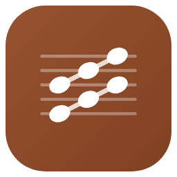
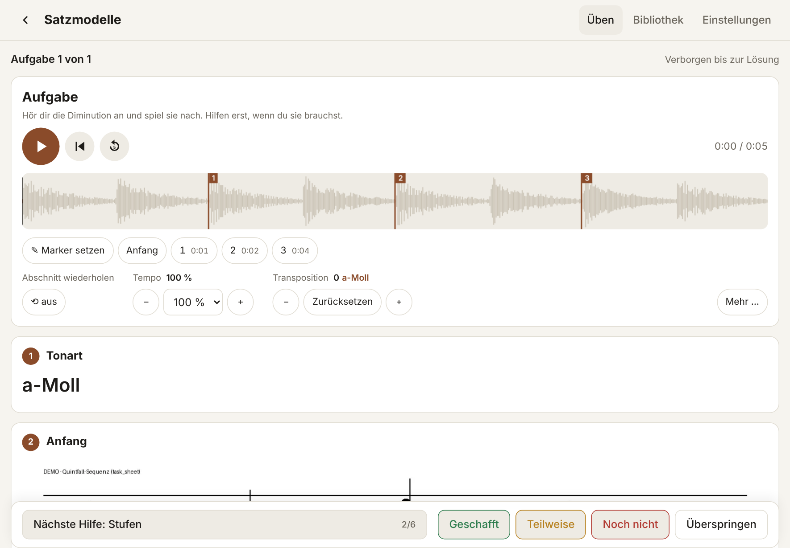
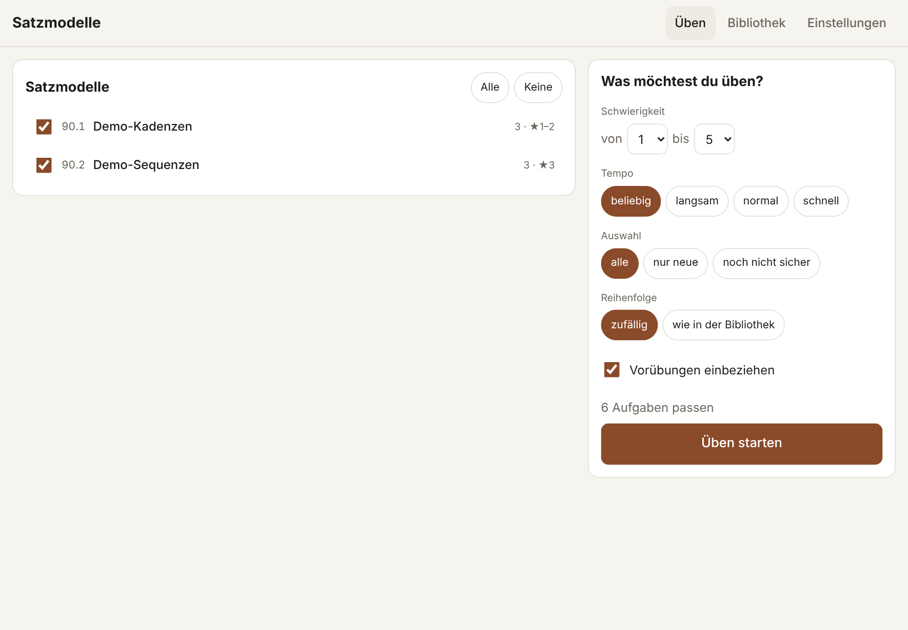

#  Satzmodelle Trainer

An Android tablet app for ear training with **Satzmodelle** (voice-leading models such as Fauxbourdon,
Quintfall or Parallelismus). You hear a short *Diminution*, try to play it back by ear, and only then
ask for help: the key, the opening notes, the scale degrees, the skeleton, finally the score and the
original recording. The answer never shows up by accident.

The app ships **without any teaching material**. You import your own library (a folder or zip in a
[simple format](docs/library-format.md)), or create exercises in the app from MusicXML exported from
Dorico, MuseScore or Sibelius.

<p>
  
  
</p>

*(Screenshots use the synthetic demo library.)*

## Features

- **Start screen as a filter**: models, difficulty, tempo variant, only new or not yet secure, random order.
- **Hint ladder**: key → opening → degrees → skeleton → score → original and piece. Order and steps are
  configurable; blind mode hides even the model's name until the end.
- **Player for practising by ear**: speed 50–150 % without changing pitch, transposition (exact for
  MusicXML, pitch-shifted for recordings), **markers** you place while listening to split a piece into
  sections, jump to them and repeat one section, optional count-in, background playback with
  lock-screen controls.
- **Record your attempts** and listen back next to the original.
- **Own exercises from MusicXML**: rendered as a score, synthesised (piano, harpsichord, organ), so any
  tempo and key works.
- **Progress and statistics**: self-rating per exercise, history, "not yet secure" filter; a statistics
  page shows how secure each piece is, success rate, hints needed, strong and weak models, weekly
  activity, and what to practise next. Pieces removed from the library keep their progress.
- **Google Drive (optional)**: progress sync, full sync of library and own material, backups, all in the
  hidden app folder of your own Drive.
- **Backups**: one file with everything, restore by merging or replacing.
- **Self-updating**: every push to `main` builds a signed APK; the installed app offers the update.
- German interface, English optional; light, dark or automatic theme; tablet first, phone works.

## Install

Download the APK from the project page: **<https://nzumbusch.github.io/satzmodelle/>**. Android asks
once to allow installing from this source. Later versions install from inside the app
(*Einstellungen → Über → Nach Updates suchen*).

Then import a library (*Bibliothek importieren*). To try the app without material, generate the
synthetic demo library:

```bash
python3 tools/make_demo_library.py demo --zip demo.zip --format mp3   # needs Pillow; mp3 needs ffmpeg
```

## Your material stays yours

The library is stored only in the app's private storage on the device and excluded from Android
backups. The app has no analytics. It goes online only for what you turn on: the update check
(GitHub Pages) and Google Drive sync into your own Drive. This repository never contains teaching
material; CI enforces that ([privacy check](tools/privacy_check.py)).

## Documentation

| | |
|---|---|
| [Library format](docs/library-format.md) | folder layout, `model.json`, roles, MusicXML scores |
| [Architecture](docs/architecture.md) | how the app is put together |
| [Design decisions](docs/design.md) | what the app does and deliberately does not do, and why |
| [Google Drive and backups](docs/google-drive.md) | sync, backups, one-time Google Cloud setup |
| [Releases and updates](docs/releases.md) | versions, signing, CI, self-update |
| [Development](docs/development.md) | setup, tests, tools, building a library from a raw archive |

## Tech

Svelte 5, TypeScript, Vite, Capacitor 8 (Android), IndexedDB, Web Audio with
[SoundTouch](https://github.com/cutterbl/SoundTouchJS) for time-stretching,
[OpenSheetMusicDisplay](https://opensheetmusicdisplay.org/) for scores, small native plugins in Java.
